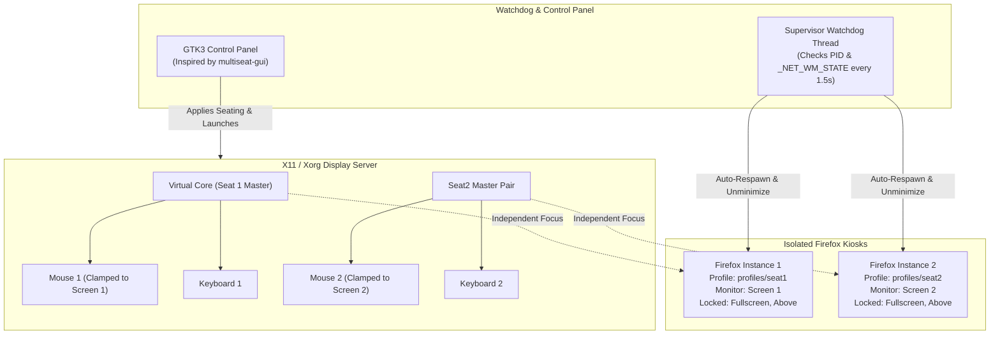

# XInput Pseudo-Seating & Dual Firefox Kiosk Control Panel

> A lightweight, rock-solid multiseat solution on single or dual GPUs using **Multi-Pointer X (MPX)**, coordinate transformation matrix screen confinement, and automated **non-minimizable / non-closable Firefox kiosks** with isolated profiles.

---

## Why Pseudo-Seating via XInput?

Traditional multiseat solutions (such as DRM leases via `drm-lease-manager` or multiple Xorg servers) frequently suffer from:
- **DRM Master contention** (Plymouth / LightDM freezes on boot).
- **Complex guest account provisioning** (creating phantom users without passwords on the login screen).
- **Display manager deadlocks** and VT thrashing.

**XInput Pseudo-Seating** bypasses all of this by operating within a single unified display server session:
1. **Multi-Pointer X (MPX):** XInput 2 natively supports multiple master pointers and keyboards. Seat 1 uses `Virtual core`, while Seat 2 uses `Seat2 pointer` and `Seat2 keyboard`.
2. **True Focus Separation:** Each master device maintains independent window focus. Seat 1 and Seat 2 users can click and type simultaneously in separate windows without stealing focus from each other!
3. **Hardware Boundary Confinement:** Mouse pointers are mathematically clamped to their respective physical screens using XInput Coordinate Transformation Matrices.
4. **Dual Firefox Kiosks:** Launches independent Firefox instances with dedicated profiles, fullscreen locked, no titlebars/controls, and an automated supervisor watchdog that instantly un-minimizes or respawns if closed.

---

## Architecture



---

## Key Features

- **Device Discovery & Detection:**
  - Automated detection of all monitors and resolutions via `xrandr` (with sysfs DRM fallback).
  - Complete parsing of XInput hierarchy (`xinput list`), distinguishing physical slaves from internal XTEST devices.
  - Correlation with kernel `/sys/class/input/` and `/dev/input/by-id/` devices.
  - **Interactive Device Finder:** Click or press a key on any device to instantly identify and select it!
- **Multi-Pointer X (MPX) Seating:**
  - Creates and tears down secondary master pairs (`Seat2 pointer` / `Seat2 keyboard`).
  - Reattaches slave mice and keyboards to their designated seat masters.
  - Generates exact Coordinate Transformation Matrices (`[w/W, 0, x/W,  0, h/H, y/H,  0, 0, 1]`) ensuring mouse pointers physically cannot leave their assigned monitors.
  - One-click restore: returns all devices to core and cleans up custom masters.
- **Robust Firefox Kiosk Management:**
  - Dedicated profile isolation (`~/.config/xinput-seats/profiles/seat1` and `seat2`).
  - Custom `user.js` and enterprise `policies.json` disabling window close shortcuts (`Ctrl+W`, `Ctrl+Q`), developer tools, updates, and crash prompts.
  - Screen placement using `--kiosk --kiosk-monitor <index>` and EWMH coordinate locking.
  - **Non-Minimizable & Non-Closable Enforcement:** Strips `_NET_WM_ACTION_CLOSE` and `_NET_WM_ACTION_MINIMIZE` from `_NET_WM_ALLOWED_ACTIONS` using `xprop`.
  - **Supervisor Watchdog:** Runs a background monitoring daemon that auto-respawns Firefox if terminated and automatically un-minimizes if hidden.
- **GTK3 Control Panel UI:**
  - Inspired by the Adwaita card styling from `multiseat-gui`.
  - Real-time status cards (Active Seats, Master Pairs, Connected Monitors, Running Kiosks).
  - Dual-Seat live test pad for verifying simultaneous input side-by-side.
  - Raw JSON configuration editor with syntax validation and reset options.
  - Fully headless CLI support for automated startup and systemd integration.

---

## Directory Structure

```
Projects/xinput/
├── main.py                     # Main application entry point (GUI & CLI)
├── start.sh                    # Launcher script with dependency checks
├── xinput-multiseat.desktop    # Desktop shortcut
├── requirements.txt            # Python dependencies
├── core/
│   ├── device_manager.py       # XRandR, XInput, sysfs input enumeration & sniffer
│   ├── xinput_seating.py       # MPX master pair creation, reattachment, matrix confinement
│   ├── kiosk_manager.py        # Firefox profile generator, kiosk launcher & watchdog
│   └── config_manager.py       # JSON configuration manager (~/.config/xinput-seats/)
└── gui/
    ├── app.py                  # GTK3 Application Window & HeaderBar
    ├── styles.py               # Modern card CSS styling
    ├── widgets.py              # StatusCard and reusable components
    └── tabs/
        ├── dashboard_tab.py    # Status cards, action buttons, live activity log
        ├── seats_tab.py        # Per-seat hardware dropdowns and setup
        ├── devices_tab.py      # Hardware discovery treeviews & interactive finder
        ├── test_tab.py         # Simultaneous dual-seat typing pad & process viewer
        └── config_tab.py       # JSON editor & profile folder tools
```

---

## Quick Start

### 1. Launch the GUI
```bash
cd ~/Projects/xinput
./start.sh
```
Or directly with Python:
```bash
python3 ~/Projects/xinput/main.py
```

### 2. Auto-Detect Hardware
In the Control Panel:
1. Click **🪄 Auto-Setup Wizard** in the headerbar, or **⚡ Auto-Detect & Assign** in the **Seats & Kiosks** tab.
2. The system automatically inspects connected displays, mice, and keyboards and populates Seat 1 and Seat 2.
3. Click **💾 Save Configuration**.

### 3. Start Seating & Kiosks
Click **🟢 Start Seating & Kiosks** on the Dashboard:
- Seat 2 master pointer and keyboard are created.
- Devices are reattached and mouse pointers are clamped to their respective screens.
- Firefox launches on Monitor 1 and Monitor 2 with separate profiles in locked kiosk mode.
- The supervisor watchdog activates to ensure neither kiosk can be closed or minimized.

---

## CLI & Headless Usage

The application can be driven entirely from the command line (e.g. for autostart scripts or headless deployments):

| Command | Description |
|---|---|
| `./start.sh --status` | Display connected monitors, XInput masters, and active kiosks |
| `./start.sh --auto` | Auto-detect hardware and save seat configuration |
| `./start.sh --start` | Apply seating mappings and launch kiosks with supervisor |
| `./start.sh --stop` | Terminate all kiosks and reset XInput devices to core |
| `./start.sh --reset-devices` | Reset XInput devices to core without touching kiosks |

---

## Dependencies

- **Python 3.8+** with PyGObject (`python-gobject` or `python3-gi`)
- **X.Org utilities:** `xorg-xinput`, `xorg-xrandr`, `wmctrl`, `xdotool`
- **Web Browser:** `firefox`
