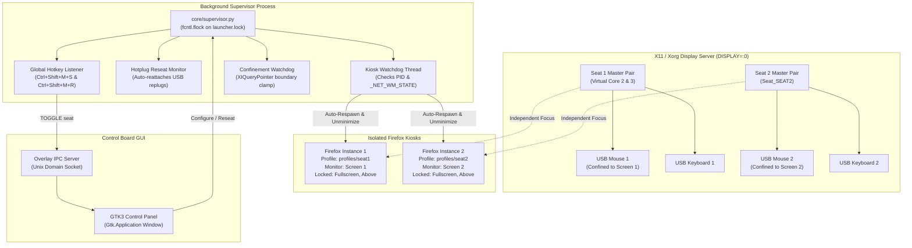

# XInput Pseudo-Seating & Dual Firefox Kiosk Control Panel

> A lightweight, production-ready multiseat kiosk platform on single or dual GPUs using **Multi-Pointer X (MPX)**, pointer barrier screen confinement, hardened **non-minimizable / non-closable Firefox kiosks** with isolated profiles, and **automatic startup recovery for unattended operation and power outages**.

---

## Why Pseudo-Seating via XInput?

Traditional Linux multiseat solutions (such as DRM leases via `drm-lease-manager` or multiple concurrent Xorg display servers) frequently suffer from:
- **DRM Master contention** (Plymouth / LightDM / GDM boot freezes).
- **Complex guest account provisioning** (creating phantom users without passwords on the login screen).
- **Display manager deadlocks** and VT switching thrashing.

**XInput Pseudo-Seating** eliminates display manager friction by operating within a single unified X11 session:
1. **Multi-Pointer X (MPX):** Native XInput 2 master pairs. Seat 1 uses `Virtual core pointer` and `Virtual core keyboard`, while Seat 2 uses dedicated masters (`Seat_SEAT2 pointer` and `Seat_SEAT2 keyboard`).
2. **True Focus Separation:** Each master device maintains independent window focus. Seat 1 and Seat 2 users can click, scroll, and type simultaneously in separate windows without stealing focus from each other.
3. **Hardware Boundary Confinement:** Mouse pointers are clamped to their respective physical screens using XFixes pointer barriers and a background confinement watchdog.
4. **Hardened Dual Firefox Kiosks:** Launches independent Firefox instances with dedicated profiles (`profiles/seat1`, `profiles/seat2`), fullscreen locked, no titlebars/controls, system-wide enterprise policies, and an automated supervisor watchdog that un-minimizes or respawns if closed.
5. **Power Outage Resilience & Auto-Reseating:** Automatically identifies connected screen resolutions, detects attached USB mice and keyboards, reseats the workstations, and launches the kiosks on startup without human intervention.

---

## Architecture



---

## Key Features

### 1. Super Keyboard Shortcut (`Ctrl + Shift + M + S`) Overlay
- Pressing **`Ctrl + Shift + M + S`** in kiosk mode overlays the Control Board GUI on top of the fullscreen locked browser on the specific screen of the user who triggered it.
- Uses XInput 2 passive raw event interception (`core/hotkey_manager.py`) to detect the hotkey without grab conflicts or blocking application keystrokes.
- Dynamically correlates the triggering keyboard device to its seat and centers the GUI onto that seat's physical screen.
- Pauses kiosk supervisor focus-reclaiming for that seat while the overlay is visible.
- Pressing **`Ctrl + Shift + M + S`** again, pressing **`Esc`**, or clicking **`⬇ Hide Overlay`** dismisses the overlay and immediately restores keyboard focus to the kiosk.
- Fast soft reseat without restarting browsers via **`Ctrl + Shift + M + R`**.

### 2. Power Outage Recovery & Launch on Startup
- Automated boot sequence via `core/supervisor.py` and `launcher.py` with exponential backoff on retryable states (`NEED_DISPLAYS`, `NEED_DEVICES`).
- Generates a hardened systemd user unit (`~/.config/systemd/user/xinput-multiseat.service`) with `Restart=on-failure`, `WantedBy=graphical-session.target`, and `After=graphical-session.target`.
- CLI flags to enable (`--enable-autostart`), disable (`--disable-autostart`), or toggle (`--toggle-autostart`).
- Zero manual repair needed after hard power cuts.

### 3. Screen Resolution Auto-Identification & Display Safeguards
- Communicates directly with system display engines via `xrandr` with sysfs DRM fallback (`core/device_manager.py`).
- Automatically tracks physical display names, exact resolutions (`WxH`), placement offsets (`+X+Y`), and primary monitor roles.
- `DisplayGuard` monitors runtime display disconnection; if a monitor is unplugged mid-session, the affected seat sleeps safely without leaving devices floating, and resumes automatically when reconnected.

### 4. Hardware Disambiguation & USB Port Binding
- Priority-queue peripheral resolver (`core/peripheral_resolver.py`):
  - **Tier 0 (Locked Identity):** Explicit device name and hardware ID in `config.json`.
  - **Tier 1 (Short-Term Memory):** Restores seat after unplug/replug without reshuffling.
  - **Tier 2 (Stand-in):** Adopts available external USB peripherals when a locked device is absent; automatically promoted if continuously connected for 3 hours.
- **Identical Peripherals (USB Port Binding):** Two identical mouse/keyboard kits without serial numbers are disambiguated by their physical USB port path (e.g. `1-1.2`). The Seats tab provides a "Bind to this USB port" toggle to anchor identical hardware to specific seats.

### 5. Firefox Lockdown & Enterprise Policies
- Enterprise policies template generated via `./install-policies.sh` into `/etc/firefox/policies/policies.json` or `<firefox dir>/distribution/policies.json`.
- Disables developer tools, `about:config`, browser updates, telemetry, studies, default bookmarks, and download prompts.
- Hardens profile `user.js` (`security.fileuri.strict_origin_policy=true`, `devtools.policy.disabled=true`).
- **URL Escaping & Validation:** Kiosk URLs are strictly validated to `http://`, `https://`, or `about:`, with JSON-escaped string formatting.
- **Note on Browser Close Shortcuts:** Standard Firefox does not expose page-level suppression of `Ctrl+W` / `Ctrl+Q`. The supervisor watchdog actively enforces kiosk uptime, stripping close/minimize window manager actions and immediately respawning any terminated browser.

### 6. Super-Key Shield & XKB Restoration
- Protects fullscreen kiosks from accidental desktop navigation or system menu triggers by patching `xkb_symbols` via `xkbcomp` (`core/kiosk_shield.py`).
- Saves original keymap backups to `~/.local/state/xinput-seats/keymaps/`.
- Uninstallation and system shutdown cleanly restore original keymaps before removing custom files.
- Manual recovery command available anytime: `./start.sh --restore-keymaps`.

### 7. Optional Privacy Reset on Idle
- Optional setting: `settings.idle_reset_minutes` (default 0 = disabled).
- When enabled, if a seat experiences zero user input for $N$ minutes, Firefox on that seat is restarted with a wiped cache, cookie jar, and history while preserving `user.js` configuration.

---

## Directory Structure

```
dual-kiosk/
├── main.py                     # Primary entry point (Gtk.Application GUI & CLI dispatcher)
├── launcher.py                 # CLI launcher & supervisor runner
├── launch.sh                   # Supervisor launcher wrapper
├── start.sh                    # Standard GUI / CLI startup script with preflight checks
├── install-policies.sh         # System-wide Firefox enterprise policies installer
├── install-launcher.sh         # Desktop application shortcut installer
├── uninstall.sh                # Clean uninstaller script
├── uninstaller.py              # CLI uninstaller runner
├── xinput-multiseat.desktop    # XDG Desktop application entry
├── requirements.txt            # Python dependencies
├── pyproject.toml              # Pytest & Ruff configuration
├── core/
│   ├── paths.py                # Central XDG path resolver (~/.config & ~/.local/state)
│   ├── preflight.py            # Environment & dependency validation (Wayland, tools, packages)
│   ├── supervisor.py           # Persistent flock supervisor daemon & hotplug loop
│   ├── session_manager.py      # StartResult lifecycle coordinator (start/stop/reseat)
│   ├── device_manager.py       # XRandR, sysfs DRM, XInput & USB input discovery
│   ├── xinput_seating.py       # MPX master pair engine, device reattachment & cleanup
│   ├── pointer_barriers.py     # XFixes pointer barriers & ConfinementWatchdog thread
│   ├── peripheral_resolver.py  # Peripheral priority queue & physical USB port matcher
│   ├── kiosk_manager.py        # Firefox profile generator, watchdog, & idle privacy reset
│   ├── kiosk_shield.py         # Super key XKB symbol patcher & keymap restorer
│   ├── hotkey_manager.py       # OverlayIPCServer (Unix domain socket) & hotkey dispatcher
│   ├── combo_hotkey.py         # Raw XInput2 event parser & ComboTracker state machine
│   ├── display_guard.py        # Runtime monitor disconnect watchdog & modal alerts
│   ├── autostart.py            # Systemd user service & desktop autostart generator
│   ├── config_manager.py       # Thread-safe config.json with flock and automatic backups
│   ├── schema.py               # JSON configuration schema validation & defaults
│   ├── logging_setup.py        # Rotating file logger (1MB x 3) in ~/.local/state/
│   ├── x11.py                  # Ctypes X11/XInput/XFixes loader & global error handler
│   └── uninstaller.py          # Complete teardown and system restore logic
├── gui/
│   ├── app.py                  # GTK3 Application Window & HeaderBar
│   ├── display_dialog.py       # Display disconnect / retry modal dialog
│   ├── styles.py               # CSS styling and dark theme integration
│   ├── widgets.py              # StatusCard and reusable UI components
│   └── tabs/
│       ├── dashboard_tab.py    # Status cards, startup toggle, live activity log
│       ├── seats_tab.py        # Per-seat hardware dropdowns & USB port binding
│       ├── devices_tab.py      # Hardware discovery treeviews & interactive device finder
│       ├── test_tab.py         # Simultaneous dual-seat typing pad & process viewer
│       └── config_tab.py       # JSON editor & schema validation tools
└── tests/                      # Automated mock-based test suite (100 tests)
    ├── fixtures/               # Handcrafted raw XInput and XRandR output fixtures
    └── test_*.py               # Unit tests covering all subsystems (see Test Plan)
```

---

## Quick Start

### 1. Install System Dependencies
Ensure required system utilities are installed:
```bash
# Debian / Ubuntu / Mint:
sudo apt update
sudo apt install -y x11-xserver-utils xinput x11-utils xdotool wmctrl x11-xkb-utils \
                    python3 python3-pip python3-gi python3-gi-cairo gir1.2-gtk-3.0 \
                    firefox

# Arch Linux:
sudo pacman -S --needed xorg-xinput xorg-xrandr xdotool wmctrl xorg-xkbcomp \
                        python python-gobject gtk3 firefox
```

### 2. Install Firefox Lockdown Policies (Recommended)
Install system-wide enterprise policies to lock down developer tools, extensions, and settings:
```bash
sudo ./install-policies.sh
```

### 3. Launch the Control Board GUI
```bash
./start.sh
```
Or directly with Python:
```bash
python3 main.py
```

### 4. Auto-Detect Hardware
In the Control Panel:
1. Click **🪄 Auto-Setup Wizard** in the headerbar, or **⚡ Auto-Detect & Assign** in the **Seats & Kiosks** tab.
2. The system queries connected displays and USB devices, assigning them to Seat 1 and Seat 2.
3. Review assignments and click **💾 Save Configuration**.

### 5. Enable Launch on Startup (Unattended Boot)
- In the Dashboard toolbar, click the **`⚡ Launch on Startup`** toggle button, or run:
  ```bash
  ./start.sh --enable-autostart
  ```
- This configures `systemd --user` to automatically start kiosks upon graphical desktop login.

### 6. Start Kiosks & Seating
Click **🟢 Start Seating & Kiosks** on the Dashboard (or run `./start.sh --start`):
- Seat 2 master pointer and keyboard are created.
- Devices are attached to their respective masters.
- Mouse pointers are confined to their screens.
- Firefox launches on both monitors in fullscreen locked mode.
- The supervisor monitors browser health and hotplugged devices continuously.

---

## CLI & Headless Usage

The application can be driven entirely from the command line (e.g. for systemd services or headless deployments):

| Command | Description |
|---|---|
| `./start.sh --status` | Display connected monitors, screen resolutions, USB devices, kiosks, and autostart status |
| `./start.sh --auto` | Auto-detect screen resolutions & USB input devices and save configuration |
| `./start.sh --auto-start` | Run automatic boot / power outage recovery sequence (retries until displays/devices appear) |
| `./start.sh --enable-autostart` | Enable launch on startup via systemd user service & XDG autostart |
| `./start.sh --disable-autostart` | Disable launch on startup |
| `./start.sh --toggle-autostart` | Toggle launch on startup state |
| `./start.sh --start` | Apply seating mappings and launch kiosks with background supervisor |
| `./start.sh --stop` | Terminate all kiosks, close GUI, and reset XInput devices to core |
| `./start.sh --reset-devices` | Reset all XInput devices to core without terminating browsers |
| `./start.sh --restore-keymaps` | Restore original XKB keymaps (re-enables Super key) and exit |
| `./start.sh --overlay` | Launch or show Control Board GUI in overlay mode on top of kiosks |
| `./start.sh --toggle-overlay --seat seat2` | Toggle Control Board overlay on a specific seat via IPC or launch |
| `./start.sh --uninstall` | Fully restore system to pre-setup state (removes masters, configs, profiles) |

---

## Testing & Verification

The repository includes a comprehensive, mock-based test suite that runs without requiring physical hardware or an active X server:

```bash
# Run the test suite:
pytest -q

# Run with coverage details:
pytest -v
```

All 100 tests run against handcrafted fixtures in `tests/fixtures/` and mock interfaces for `xinput`, `xrandr`, sysfs, and Firefox processes.

---

## Uninstallation & System Restore

To cleanly reset all input devices to Virtual core, stop kiosks, and remove custom configurations:
```bash
./uninstall.sh
```
Options:
- `./uninstall.sh --yes` : Skip interactive confirmation.
- `./uninstall.sh --keep-config` : Retain `~/.config/xinput-seats` config and browser profiles.
- `./uninstall.sh --dry-run` : Preview teardown actions without modifying the system.

If the system ever terminates abruptly without running cleanup, restore your desktop immediately with:
```bash
./start.sh --stop
./start.sh --restore-keymaps
```

---

## Scope & Limitations

1. **X11 / Xorg Requirement:**
   - Multi-Pointer X (MPX) and pointer barriers are features of the X11 protocol (XInput 2.x and XFixes 5.x). They are **not supported under pure Wayland sessions**. A working X11 display server or XWayland rootful session is required.
2. **Shared-User Unix Session:**
   - Both seats run under the same logged-in Linux user account. Application isolation is achieved via distinct Firefox browser profiles, separate window focus, and distinct input masters, but not separate Unix UIDs or filesystem permission boundaries.
3. **Dual-Seat Scope:**
   - The platform is designed and optimized specifically for 2 seats (Primary Virtual Core + Secondary MPX Master Pair).
