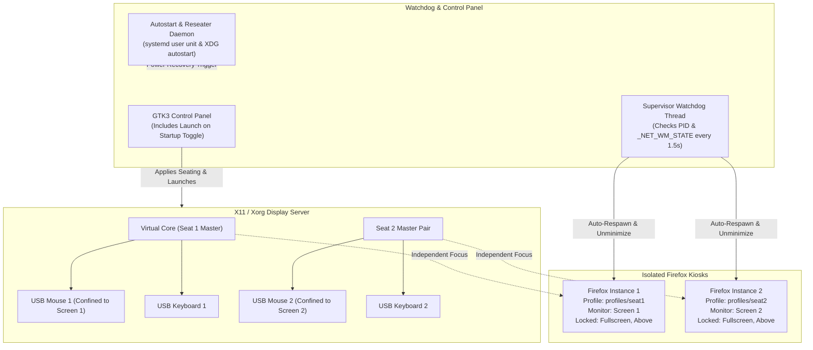

# XInput Pseudo-Seating & Dual Firefox Kiosk Control Panel

> A lightweight, rock-solid multiseat solution on single or dual GPUs using **Multi-Pointer X (MPX)**, pointer barrier screen confinement, automated **non-minimizable / non-closable Firefox kiosks** with isolated profiles, and **automatic startup recovery for power outages**.

---

## Why Pseudo-Seating via XInput?

Traditional multiseat solutions (such as DRM leases via `drm-lease-manager` or multiple Xorg servers) frequently suffer from:
- **DRM Master contention** (Plymouth / LightDM freezes on boot).
- **Complex guest account provisioning** (creating phantom users without passwords on the login screen).
- **Display manager deadlocks** and VT thrashing.

**XInput Pseudo-Seating** bypasses all of this by operating within a single unified display server session:
1. **Multi-Pointer X (MPX):** XInput 2 natively supports multiple master pointers and keyboards. Seat 1 uses `Virtual core`, while Seat 2 uses `Seat_SEAT2 pointer` and `Seat_SEAT2 keyboard`.
2. **True Focus Separation:** Each master device maintains independent window focus. Seat 1 and Seat 2 users can click and type simultaneously in separate windows without stealing focus from each other.
3. **Hardware Boundary Confinement:** Mouse pointers are clamped to their respective physical screens using XFixes pointer barriers and XInput Coordinate Transformation Matrices.
4. **Dual Firefox Kiosks:** Launches independent Firefox instances with dedicated profiles, fullscreen locked, no titlebars/controls, and an automated supervisor watchdog that instantly un-minimizes or respawns if closed.
5. **Power Outage Resilience & Auto-Reseating:** Automatically identifies connected screen resolutions, detects attached USB mice and keyboards, reseats the workstations, and launches the kiosks on startup without user intervention.

---

## Architecture



---

## Key Features

- **Super Keyboard Shortcut (`Ctrl + Shift + M + S`) Overlay:**
  - Pressing **`Ctrl + Shift + M + S`** in kiosk mode instantly overlays the Control Board GUI on top of the fullscreen locked browser on the screen of the user who triggered it.
  - Uses XInput 2 passive raw event interception to detect the hotkey without grab conflicts or blocking application keystrokes.
  - Automatically correlates the triggering keyboard device to its seat and moves/centers the GUI onto that seat's physical screen.
  - Sets `_NET_WM_STATE_ABOVE` and binds the user's seat keyboard and pointer focus directly to the Control Board.
  - Pauses kiosk supervisor watchdog focus reclaiming for that seat while the overlay is visible.
  - Pressing **`Ctrl + Shift + M + S`** again, pressing **`Esc`**, or clicking **`⬇ Hide Overlay`** dismisses the overlay and immediately restores the seat's keyboard focus to the kiosk.
  - Works whether the GUI was already running or running in headless/autostart mode (auto-launches the GUI if needed).
- **Power Outage Recovery & Launch on Startup:**
  - One-click toggle in the GUI dashboard: **`⚡ Launch on Startup`**.
  - CLI flags to enable (`--enable-autostart`), disable (`--disable-autostart`), or toggle (`--toggle-autostart`).
  - Generates both a systemd user service (`~/.config/systemd/user/dual-kiosk.service`) and an XDG autostart entry (`~/.config/autostart/dual-kiosk.desktop`).
  - Resilient unattended boot: waits for display server initialization, auto-identifies screen resolutions, auto-assigns USB devices, applies seating, and launches both kiosks automatically after power recovery.
- **Screen Resolution Auto-Identification:**
  - Communicates directly with system display engines via `xrandr` and sysfs DRM (`core/screen_utils.py`).
  - Automatically queries and tracks physical display names, exact resolutions (`WxH`), placement offsets (`+X+Y`), and primary monitor roles.
- **USB Device Auto-Assignment:**
  - Inspects Linux sysfs (`/sys/class/input`, `/proc/bus/input/devices`, `/sys/bus/usb/devices`) and correlates them with `xinput` node hierarchies.
  - Distinguishes external physical USB mice and keyboards from built-in laptop devices or virtual XTEST nodes.
  - Automatically maps:
    - **Seat 1:** Display 1 (Primary/leftmost) + First connected USB mouse + First connected USB keyboard.
    - **Seat 2:** Display 2 + Second connected USB mouse + Second connected USB keyboard.
    - Gracefully falls back to available input hardware if fewer than two USB pairs are present.
- **Multi-Pointer X (MPX) Seating:**
  - Creates and manages secondary master pairs (`Seat_SEAT2 pointer` / `Seat_SEAT2 keyboard`).
  - Reattaches slave mice and keyboards (including sibling nodes like consumer control keys) to their designated seat masters.
  - Confines pointers to their assigned screens using XFixes pointer barriers.
  - One-click restore: returns all devices to core and cleans up custom masters.
- **Robust Firefox Kiosk Management:**
  - Dedicated profile isolation (`~/.config/xinput-seats/profiles/seat1` and `seat2`).
  - Custom `user.js` and enterprise `policies.json` disabling window close shortcuts (`Ctrl+W`, `Ctrl+Q`), developer tools, updates, and crash prompts.
  - **Non-Minimizable & Non-Closable Enforcement:** Strips `_NET_WM_ACTION_CLOSE` and `_NET_WM_ACTION_MINIMIZE` from `_NET_WM_ALLOWED_ACTIONS`.
  - **Supervisor Watchdog:** Runs a background monitoring daemon that auto-respawns Firefox if terminated and automatically un-minimizes if hidden.
- **GTK3 Control Panel UI:**
  - Status cards (Active Seats, Master Pairs, Connected Monitors, Running Kiosks).
  - Quick action toolbar with Launch on Startup toggle, Start/Stop, and Restart controls.
  - Dual-seat live test pad for verifying simultaneous input side-by-side.
  - Clean uninstaller (`./uninstall.sh` or `python3 main.py --uninstall`).

---

## Directory Structure

```
dual-kiosk/
├── main.py                     # Main application entry point (GUI & CLI)
├── start.sh                    # Launcher script with dependency checks
├── uninstall.sh                # Clean uninstaller script
├── uninstaller.py              # CLI uninstaller runner
├── xinput-multiseat.desktop    # Desktop shortcut
├── requirements.txt            # Python dependencies
├── core/
│   ├── autostart.py            # Startup service generator & power outage reseating runner
│   ├── screen_utils.py         # Screen resolution detection & display querying
│   ├── device_manager.py       # XRandR, XInput, sysfs input & USB device discovery
│   ├── pointer_barriers.py     # XFixes pointer boundary confinement
│   ├── xinput_seating.py       # MPX master pair creation, reattachment & confinement
│   ├── kiosk_manager.py        # Firefox profile generator, kiosk launcher & watchdog
│   ├── hotkey_manager.py       # Super shortcut (Ctrl+Shift+M+S) listener & overlay IPC
│   ├── config_manager.py       # JSON configuration manager (~/.config/xinput-seats/)
│   └── uninstaller.py          # Complete teardown and system restore logic
└── gui/
    ├── app.py                  # GTK3 Application Window & HeaderBar
    ├── styles.py               # Modern card CSS styling
    ├── widgets.py              # StatusCard and reusable components
    └── tabs/
        ├── dashboard_tab.py    # Status cards, startup toggle, live activity log
        ├── seats_tab.py        # Per-seat hardware dropdowns and setup
        ├── devices_tab.py      # Hardware discovery treeviews & interactive finder
        ├── test_tab.py         # Simultaneous dual-seat typing pad & process viewer
        └── config_tab.py       # JSON editor & profile folder tools
```

---

## Quick Start

### 1. Launch the GUI
```bash
./start.sh
```
Or directly with Python:
```bash
python3 main.py
```

### 2. Auto-Detect Hardware & Resolutions
In the Control Panel:
1. Click **🪄 Auto-Setup Wizard** in the headerbar, or **⚡ Auto-Detect & Assign** in the **Seats & Kiosks** tab.
2. The system queries the system, identifies screen resolutions and attached USB devices, and assigns them to Seat 1 and Seat 2.
3. Click **💾 Save Configuration**.

### 3. Toggle Launch on Startup (Power Outage Recovery)
- In the Dashboard toolbar, click the **`⚡ Launch on Startup`** toggle button to enable automatic startup.
- The app installs the systemd user service and XDG desktop autostart entry so the kiosks will automatically reseat and launch on reboot.

### 4. Start Seating & Kiosks
Click **🟢 Start Seating & Kiosks** on the Dashboard:
- Seat 2 master pointer and keyboard are created.
- Devices are reattached and mouse pointers are confined to their respective screens.
- Firefox launches on Monitor 1 and Monitor 2 with separate profiles in locked kiosk mode.
- The supervisor watchdog activates to ensure neither kiosk can be closed or minimized.

---

## CLI & Headless Usage

The application can be driven entirely from the command line (e.g. for systemd services or headless deployments):

| Command | Description |
|---|---|
| `./start.sh --status` | Display connected monitors, screen resolutions, USB devices, kiosks, and autostart status |
| `./start.sh --auto` | Auto-detect screen resolutions & USB input devices and save configuration |
| `./start.sh --auto-start` | Run automatic boot / power outage recovery sequence (reseats hardware & launches kiosks) |
| `./start.sh --enable-autostart` | Enable launch on startup via systemd user service & XDG autostart |
| `./start.sh --disable-autostart` | Disable launch on startup |
| `./start.sh --toggle-autostart` | Toggle launch on startup state |
| `./start.sh --start` | Apply seating mappings and launch kiosks with supervisor |
| `./start.sh --stop` | Terminate all kiosks and reset XInput devices to core |
| `./start.sh --reset-devices` | Reset XInput devices to core without touching kiosks |
| `./start.sh --restore-keymaps` | Restore original XKB keymaps (re-enables Super key) |
| `./start.sh --overlay` | Launch or show Control Board GUI in overlay mode on top of kiosk mode |
| `./start.sh --toggle-overlay --seat seat2` | Toggle Control Board GUI overlay on a specific seat via IPC or launch |
| `./start.sh --uninstall` | Fully restore system to pre-setup state (removes masters, configs, profiles) |

---

## Uninstallation

To cleanly reset all input devices to Virtual core, stop kiosks, and remove custom configs/profiles:
```bash
./uninstall.sh
```
Options:
- `./uninstall.sh --yes` : Skip interactive confirmation.
- `./uninstall.sh --keep-config` : Retain `~/.config/xinput-seats` config and browser profiles.
- `./uninstall.sh --dry-run` : Preview teardown actions without modifying the system.

---

## Dependencies

- **Python 3.8+** with PyGObject (`python-gobject` or `python3-gi`)
- **X.Org utilities:** `xorg-xinput`, `xorg-xrandr`, `wmctrl`, `xdotool`
- **Web Browser:** `firefox`
